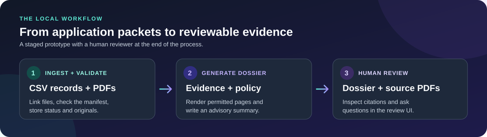
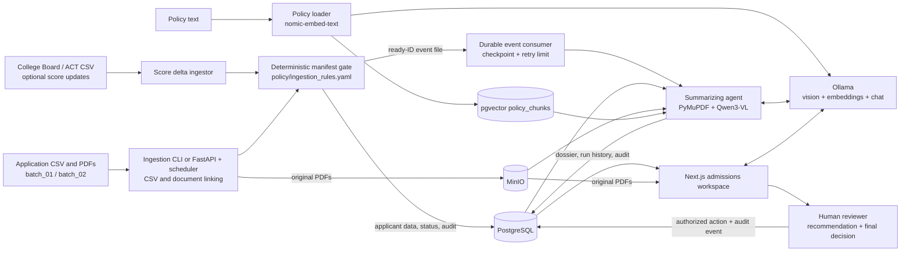

<h1 align="center">AI-Assisted College Admissions System Prototype</h1>

<p align="center"><strong>Turn application packets into evidence-backed dossiers for accountable human review.</strong><br/>A local research prototype built with Python, PostgreSQL, MinIO, Ollama, and Next.js.</p>

<p align="center">
  <a href="#what-it-does">Overview</a> ·
  <a href="#system-architecture">Architecture</a> ·
  <a href="#admissions-workspace">Workspace</a> ·
  <a href="#run-the-sample-workflow">Run the demo</a> ·
  <a href="#test-the-system">Testing</a> ·
  <a href="#detailed-documentation">Documentation</a>
</p>



## What it does

The system accepts applicant CSV records and PDFs, checks packet completeness, and prepares advisory dossiers that reviewers can inspect alongside original documents. Ingestion and dossier generation are separate stages, with an explicit handoff of applicants ready for review.

| 1 · Intake | 2 · Dossier | 3 · Human review |
| --- | --- | --- |
| Link applicant records and PDFs, check required materials, and record status and audit events. | Use permitted pages and retrieved policy text to draft sections with supporting evidence. | Inspect evidence, submit an advisory recommendation, and record an authorized final decision. |

> [!NOTE]
> The included applicants and documents are synthetic. The AI **never makes an admissions decision**. The prototype can store a recommendation and final decision only when they are explicitly submitted by a human reviewer; authentication remains simulated.

**New here?** Follow the [sample workflow](#run-the-sample-workflow) to ingest `batch_02`, generate a dossier for `APP_012`, and open the review UI. The eight steps cover every required service and dependency.

## System architecture



1. **Ingestion** reads the batch CSV, upserts applicant fields, links PDFs by applicant ID, and archives raw files in MinIO. It checks size, PDF signature, and the required document manifest without extracting PDF content. Unmatched documents are recorded as orphans.
2. **The manifest gate** applies [`policy/ingestion_rules.yaml`](policy/ingestion_rules.yaml). It routes complete packets to `READY_FOR_REVIEW`, missing documents to `AWAITING_MATERIALS`, missing required fields to `INCOMPLETE`, and integrity failures to `ERROR`. It writes an audit report and a JSON file of ready IDs. An optional score-feed CLI updates SAT/ACT/AP fields and re-runs the gate.
3. **The event consumer** accepts an `affected_ids_<runid>.json` handoff, records durable per-applicant checkpoints in `output/ingestion/event_state.json`, skips completed work, limits automatic attempts to two, and reconciles checkpoint state with PostgreSQL before invoking the model.
4. **Dossier generation** downloads permitted PDFs, renders pages with PyMuPDF, retrieves policy chunks from PostgreSQL/pgvector, and asks Ollama's `qwen3-vl:8b-instruct` model for academic, engagement, recommendation, supplement, policy, and holistic sections. It records evidence and validation results, then stores successful dossiers and run history in PostgreSQL. Personal statements are withheld from model input for human review.
5. **The admissions workspace** provides a processing dashboard, applicant review with original PDFs and grounded Q&A, reviewer recommendations, Dean final decisions, summary statistics, and a read-only IT Error Queue. Recommendation and decision actions are human initiated and written to PostgreSQL with audit events. Authentication is simulated and remains a production requirement.

PostgreSQL is the shared record for status, document metadata, dossiers, and audit/run history. MinIO holds original PDFs. The policy loader reads [`policy/riverview_admissions_policy.txt`](policy/riverview_admissions_policy.txt), which is separate from the YAML used by the ingestion gate. The older [architecture overview](docs/architecture/system_overview.md) describes a broader plan, including components not wired into this runnable workflow.

### Where data lives

| Stored artifact | Purpose |
| --- | --- |
| PostgreSQL `applicants` and `audit_logs` | Applicant fields, document metadata, current workflow status, and ingestion audit events |
| PostgreSQL `policy_chunks` | Searchable policy text and embeddings for dossier generation |
| PostgreSQL `applicant_dossier`, `dossier_generation_runs`, and `summary_audit_log` | Advisory output, its validation/run history, and agent audit events |
| MinIO `admissions-raw-docs` bucket | Original applicant PDFs, including documents reserved for human review |

The separate [`ingestion/parsing/`](ingestion/parsing/) and [`ai_agent/gateway/`](ai_agent/gateway/) modules represent earlier parsing/model interfaces; the two-pass ingestion runner does not call them, and the current dossier agent implements its own PDF/model path. The supplied [high school profiles](data/high_school_profiles/) are also not incorporated into the current agent's prompts.

### Repository map

| Component | Responsibility | Code and data |
| --- | --- | --- |
| Batch and score ingestion | Stage CSV fields, link PDFs, archive originals, process optional SAT/ACT updates | [`ingestion/`](ingestion/), [batch CLI](ingestion/run_ingestion_check.py), [score CLI](ingestion/run_score_ingest.py) |
| Manifest validation | Apply required-field, document, file-size, and PDF-signature rules; route packets by status | [`ingestion/validation/`](ingestion/validation/), [`policy/ingestion_rules.yaml`](policy/ingestion_rules.yaml) |
| Storage | Keep applicant records, statuses, audit entries, document metadata, and raw PDFs | [`storage/`](storage/), PostgreSQL, MinIO |
| Policy retrieval and dossier agent | Index policy text, render permitted PDF pages, retrieve relevant policy chunks, generate and validate advisory sections | [`ai_agent/`](ai_agent/), Ollama, pgvector |
| Event consumer | Process ready-ID handoffs with checkpoints, duplicate protection, retries, and escalation | [`ingestion/event_consumer.py`](ingestion/event_consumer.py) |
| Admissions workspace | Show processing status, dossiers, PDFs, recommendations, decisions, statistics, grounded Q&A, and IT errors | [`ui/`](ui/) |
| Data | Synthetic batches, applicant records, and school profiles | [`data/`](data/), including [`batch_01/`](data/batches/batch_01/) and [`batch_02/`](data/batches/batch_02/) |
| Policy | Hold the agent policy text and the ingestion checklist, file limits, and routing rules | [`policy/`](policy/) |
| Tests | Keep automated tests and review reproduction scripts | [`tests/`](tests/) |
| Documentation | Explain the API, architecture, agent, and review UI | [`docs/`](docs/) |
| Run output | Keep ingestion reports, ready-ID files, dossier snapshots, and test evidence | [`output/`](output/) |

## Admissions workspace

The browser separates admissions work from technical exception handling. All actions remain human controlled.

| Screen | Route | Purpose |
| --- | --- | --- |
| Home | `/` | Navigate to the available workspaces. |
| Processing Dashboard | `/review-queue` | Track application status, dossier availability, recommendations, and final decisions. |
| Applicant Review | `/applicant-review?appId=APP_012` | Compare the saved dossier with source PDFs, ask grounded questions, and submit an advisory recommendation. |
| Final Decisions | `/final-decisions` | Record the Dean of Admissions' authorized final decision after review. |
| Summary Statistics | `/statistics` | Explore applicant-pool, completeness, decision, academic, program, and representation summaries. |
| IT Error Queue | `/error-queue` | Show technical ingestion, processing, AI, and orphan-document incidents. Student-correctable missing-material cases remain in normal application processing. |
| Error Details | `/error-queue/[id]` | Inspect one technical incident and open the related applicant dossier when available. |

The Applicant Review screen places a saved dossier beside the original PDFs and provides a question-and-answer area below them. The bundled preview uses synthetic data; the walkthrough below uses `APP_012`.


*Figure 1. Applicant Review screen.*


*Figure 2. IT Error Queue.*


*Figure 3. System Error Details.*

## Run the sample workflow

These instructions start from a repository checkout on macOS or Linux and use only the synthetic sample data. Run commands from the repository root unless a step says otherwise. Windows users can follow the same stages with the [PowerShell equivalents below](#windows-powershell) and consult the [recorded Windows live test](output/live_test_setup/README.md) for additional verification; that older record contains machine-specific paths.

To get a local checkout:

```bash
git clone https://github.com/kappasprouts/MSA8770-Fall2026.git
cd MSA8770-Fall2026
```

### 1. Install prerequisites

- [Docker with Compose](https://docs.docker.com/compose/install/) for the local PostgreSQL/pgvector and MinIO services.
- Python 3.10 or newer and Node.js 20.9 or newer with npm.
- [Ollama](https://ollama.com/download) for the local vision and embedding models. Model download and inference require substantial disk space and memory; a full dossier can take several minutes.
- A **MinIO AIStor license file**. The [official container setup](https://docs.min.io/aistor/installation/container/install/) explains how to obtain a free-tier license. Save it outside the repository and note its absolute path. The local MinIO container cannot accept S3 uploads without a working license.

Check that `docker compose version`, `python3 --version`, `node --version`, `npm --version`, and `ollama --version` work before continuing.

### 2. Start the data services

```bash
cp .env.example .env
```

In `.env`, set `MINIO_LICENSE_FILE` to the **absolute path** of your downloaded license, for example `/Users/you/minio/minio.license`. The remaining example values match the local [`compose.yaml`](compose.yaml): PostgreSQL on `127.0.0.1:5432`, MinIO S3 on `127.0.0.1:9000`, and the MinIO console on `127.0.0.1:9001`. The local credentials are for this synthetic demo only.

```bash
docker compose config --quiet
docker compose up -d
docker compose ps
docker compose exec -T postgres pg_isready -U postgres -d riverview_admissions
curl -f http://127.0.0.1:9000/minio/health/live
```

Expect PostgreSQL to report that it accepts connections and the MinIO health request to succeed. A health response alone does not prove S3 uploads work; the strict ingestion run in step 6 checks the real storage path. Compose retains data in named volumes when the containers stop.

### 3. Install Python and UI dependencies

```bash
python3 -m venv .venv
source .venv/bin/activate
python -m pip install -r requirements.txt
cd ui
npm ci
cp .env.local.example .env.local
cd ..
```

Both example environment files use the same PostgreSQL database and `admissions-raw-docs` bucket. If you use different services, update the root `.env` and `ui/.env.local` consistently; if you change credentials or ports in the provided Compose stack, update `compose.yaml` too. Ingestion reads `DATABASE_URL`; the agent, policy loader, and UI read `POSTGRES_*`. The root example's `LLM_MODEL` is for the older generic gateway; `VLM_MODEL` controls the dossier agent.

If you reuse a database created before the reviewer-recommendation feature was added, apply its idempotent migration once:

```bash
docker compose exec -T postgres psql -U postgres -d riverview_admissions \
  -v ON_ERROR_STOP=1 < storage/migrations/20261102_reviewer_recommendation.sql
```

The Python CLIs need environment variables exported into their shell. After activating the virtual environment, run this in each new terminal used for backend commands:

```bash
set -a
. ./.env
set +a
```

### 4. Start Ollama and fetch the models

Start the Ollama desktop app, or run `ollama serve` in a separate terminal if it is not already running. Then:

```bash
ollama pull qwen3-vl:8b-instruct
ollama pull nomic-embed-text
ollama list
curl -f http://127.0.0.1:11434/api/tags
```

The policy loader uses `nomic-embed-text`; the dossier agent and UI chat use `qwen3-vl:8b-instruct`.

### 5. Index the admissions policy

```bash
python ai_agent/create_pgvector_once.py
```

Run this once for a new database and again after `policy/riverview_admissions_policy.txt` changes. It creates the pgvector extension when permitted and rebuilds the searchable policy chunks used by the dossier agent.

### 6. Ingest the sample batch

```bash
mkdir -p output/local_demo
python -m ingestion.run_ingestion_check --input-dir data/batches/batch_02 \
  --require-postgresql --require-object-storage \
  --output output/local_demo/batch_02_report.txt \
  --affected-ids output/local_demo/affected_ids_local_demo.json
cat output/local_demo/affected_ids_local_demo.json
```

The strict flags require real PostgreSQL and MinIO. Expect 10 applicants processed: 7 `READY_FOR_REVIEW`, 1 `AWAITING_MATERIALS`, and 2 `INCOMPLETE` for the supplied fixture. Confirm `APP_012` is in the affected-ID JSON file. The report explains each packet's routing. This file is the event handoff to the consumer; ingestion makes no model calls. Rerunning the command replaces these two local demo artifacts.

For a lightweight gate check without services, `./ingestion/run_check.sh data/batches/batch_01` or `make check` can use SQLite and simulated object storage. That mode **cannot feed a live dossier/UI run**.

### 7. Process the ready-ID event

```bash
python ingestion/event_consumer.py output/local_demo/affected_ids_local_demo.json
python -m json.tool output/ingestion/event_state.json
```

The event consumer is the recommended end-to-end handoff. It deduplicates IDs within an event, skips terminal checkpoints, checks PostgreSQL before rerunning work, and allows at most two processing attempts before escalation. Checkpoint states include `PENDING`, `PROCESSING`, `COMPLETED`, `RETRY_PENDING`, `WAITING_FOR_MATERIALS`, and `ESCALATED`.

For isolated troubleshooting only, run one known eligible applicant directly:

```bash
python ai_agent/summarizing_agent.py APP_012
```

Do not run the consumer and direct agent concurrently for the same applicant. `--force` deliberately regenerates an existing dossier and should be used only for controlled testing.

A successful run prints `DOSSIER_READY`, stores a row in `applicant_dossier`, records a `dossier_generation_runs` entry, and writes a snapshot under `output/ai_agent/`. Check the **new database run and status**, not only the CLI exit code or an older snapshot: the current agent can catch an applicant-level error and still exit with code 0. The bundled PostgreSQL container supplies `psql` for this check:

```bash
docker compose exec -T postgres psql -U postgres -d riverview_admissions \
  -c "SELECT app_id, status FROM applicants WHERE app_id = 'APP_012';"
docker compose exec -T postgres psql -U postgres -d riverview_admissions \
  -c "SELECT app_id, run_status, validation->>'passed' AS passed, created_at FROM dossier_generation_runs WHERE app_id = 'APP_012' ORDER BY created_at DESC LIMIT 1;"
```

Expect `DOSSIER_READY` for the applicant and newest generation run, with validation passed. Compare citations with original PDFs; validation does not prove every model-written claim correct.

### 8. Open the admissions workspace

In a second terminal, from the repository root:

```bash
cd ui
npm run dev
```

Open <http://localhost:3000>. Use the Processing Dashboard to open `APP_012`, inspect its dossier, use **View Full** on a PDF, and ask: “What is this applicant's unweighted GPA, and which evidence supports it?” Verify the answer against the dossier and original PDF. Submit a reviewer recommendation only as a human action, then confirm it appears in the Processing Dashboard and Final Decisions queue. The applicant selector lists only applicants with saved dossiers. Keep `.env` and `.env.local` out of Git.

Stop the UI with **Ctrl+C**. Stop the two data services with `docker compose stop`; their named volumes retain the demo database and PDFs. Use `docker compose up -d` to resume.

### Windows PowerShell

Use the same `compose.yaml`, Ollama commands, and UI URL. At step 2, use `Copy-Item .env.example .env`, then set `MINIO_LICENSE_FILE` in `.env` to your own absolute path using forward slashes, such as `C:/Users/you/minio/minio.license`. The `docker compose` commands work in PowerShell too. At step 3, replace the Unix Python setup and environment-loading commands with:

```powershell
python -m venv .venv
.\.venv\Scripts\python.exe -m pip install -r requirements.txt
Get-Content .env | ForEach-Object {
    if ($_ -match '^([A-Za-z_][A-Za-z0-9_]*)=(.*)$') {
        [Environment]::SetEnvironmentVariable($matches[1], $matches[2], 'Process')
    }
}
New-Item -ItemType Directory -Force output/local_demo | Out-Null
```

Run the Python commands from steps 5–7 with `.\.venv\Scripts\python.exe` in place of `python`, and use a single line or PowerShell backticks in place of Bash `\` continuations. Use `Get-Content output/local_demo/affected_ids_local_demo.json` in place of `cat`. In `ui`, `npm ci` and `npm run dev` work as written; copy `.env.local.example` to `.env.local` with `Copy-Item`.
