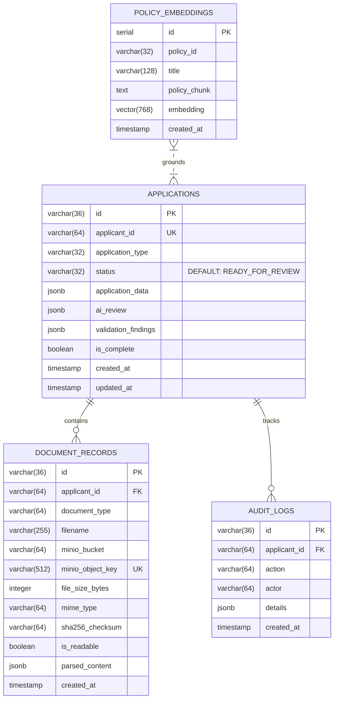

# PostgreSQL & pgvector Database Schemas

**Database Engine**: PostgreSQL 15+ with `pgvector` extension  
**ORM Implementation**: [`storage/models.py`](../../storage/models.py), [`storage/database.py`](../../storage/database.py)

> This page records an earlier `applications` design. The active ingestion
> table is `applicants` in `storage/models.py`. Its queue destination is derived
> from `status` and is not a persisted column. Use the migration in
> `storage/migrations/20261006_status_only_applicants.sql` for an existing
> PostgreSQL database. `date_of_birth` is a PostgreSQL `DATE`; use
> `storage/migrations/20261006_date_of_birth_date.sql` to convert existing text
> values. If `audit_logs` was created from the earlier SQL example, run
> `storage/migrations/20261006_audit_logs_created_at.sql` to align its timestamp
> column with the active ORM. Run
> `storage/migrations/20261031_applicant_schema_contract.sql` **after older
> migrations** to align the current contract: nullable `admission_year` and
> `admission_term`, and GPA columns of `NUMERIC(3,2)`. The older October 6 GPA
> migration used three decimal places and is superseded by this migration.

The gate's five required metadata fields remain unchanged. Missing year/term
are stored as NULL without an inferred admission cycle. CSV and direct storage
writes round GPA to two decimal places using decimal half-up rounding (3.865
becomes 3.87). GPA is a JSON number on serialization, so trailing zeroes need
not appear. Existing SQLite fallback stores upgrade transactionally on startup,
preserving rows, additional columns, indexes, triggers and review outcomes.

For an existing PostgreSQL database, back it up and apply the new migration with
the configured connection, for example:

```powershell
psql "$env:DATABASE_URL" -v ON_ERROR_STOP=1 -f storage/migrations/20261031_applicant_schema_contract.sql
```

The migration is safe to repeat. Existing GPA values are rounded to two places;
values that cannot fit `NUMERIC(3,2)` abort the transaction. New PostgreSQL
databases use the ORM schema. PostgreSQL upgrades are explicit; ingestion does
not silently alter a shared database.

---

## Officer recommendations

The active `applicants` table stores the human review separately from `final_decision`:

| Column | Type | Meaning |
| --- | --- | --- |
| `officer_recommendation` | `VARCHAR(10)`, nullable | `ACCEPT`, `REJECT`, or `WAITLIST`; null means no saved recommendation |
| `officer_recommendation_notes` | `TEXT`, nullable | Officer's comments, including line breaks; the API accepts up to 10,000 characters |
| `officer_recommendation_updated_at` | `TIMESTAMPTZ`, nullable | Time of the most recent recommendation save |

Apply `storage/migrations/20261030_officer_recommendation.sql` to existing PostgreSQL databases before running the updated UI. New databases use the ORM schema; existing SQLite fallback stores upgrade automatically. The PostgreSQL migration is safe to repeat.

`GET /api/applicants/{id}/recommendation` returns `{ appId, recommendation, notes, updatedAt, canEdit }`. `PUT` accepts `{ recommendation, notes }`, saves both fields atomically, and records `OFFICER_RECOMMENDATION_SAVED` in `audit_logs` using the prototype's simulated officer identity. Saves require `DOSSIER_READY` and no recorded final decision. The final-decision queue includes `officerRecommendation` and `officerRecommendationNotes`; its details panel displays both. A recommendation does not set or preselect a final decision. The existing final-decision value `DECLINE` is independent of the officer's `REJECT` recommendation.

---

## 1. Relational Tables Overview



---

## 2. Complete SQL DDL Definitions

```sql
-- Enable UUID and pgvector extensions
CREATE EXTENSION IF NOT EXISTS "uuid-ossp";
CREATE EXTENSION IF NOT EXISTS "vector";

-- 1. Main Applications Table
CREATE TABLE IF NOT EXISTS applications (
    id VARCHAR(36) PRIMARY KEY DEFAULT uuid_generate_v4()::text,
    applicant_id VARCHAR(64) UNIQUE NOT NULL,
    application_type VARCHAR(32) NOT NULL DEFAULT 'first_year',
    status VARCHAR(32) NOT NULL DEFAULT 'READY_FOR_REVIEW',
    application_data JSONB NOT NULL DEFAULT '{}'::jsonb,
    ai_review JSONB NOT NULL DEFAULT '{}'::jsonb,
    validation_findings JSONB NOT NULL DEFAULT '[]'::jsonb,
    is_complete BOOLEAN NOT NULL DEFAULT TRUE,
    created_at TIMESTAMP WITH TIME ZONE DEFAULT NOW() NOT NULL,
    updated_at TIMESTAMP WITH TIME ZONE DEFAULT NOW() NOT NULL
);

CREATE INDEX IF NOT EXISTS idx_applications_applicant_id ON applications(applicant_id);
CREATE INDEX IF NOT EXISTS idx_applications_status ON applications(status);

-- 2. Document Archival Records Table
CREATE TABLE IF NOT EXISTS document_records (
    id VARCHAR(36) PRIMARY KEY DEFAULT uuid_generate_v4()::text,
    applicant_id VARCHAR(64) NOT NULL,
    document_type VARCHAR(64) NOT NULL,
    filename VARCHAR(255) NOT NULL,
    minio_bucket VARCHAR(64) NOT NULL DEFAULT 'applicant-documents',
    minio_object_key VARCHAR(512) UNIQUE NOT NULL,
    file_size_bytes INTEGER NOT NULL,
    mime_type VARCHAR(64) NOT NULL DEFAULT 'application/pdf',
    sha256_checksum VARCHAR(64),
    is_readable BOOLEAN NOT NULL DEFAULT TRUE,
    parsed_content JSONB NOT NULL DEFAULT '{}'::jsonb,
    created_at TIMESTAMP WITH TIME ZONE DEFAULT NOW() NOT NULL,
    CONSTRAINT fk_applicant FOREIGN KEY (applicant_id) REFERENCES applications(applicant_id) ON DELETE CASCADE
);

CREATE INDEX IF NOT EXISTS idx_documents_applicant_id ON document_records(applicant_id);
CREATE INDEX IF NOT EXISTS idx_documents_type ON document_records(document_type);

-- 3. Immutable Audit Logs Table (Trust Boundary 2)
CREATE TABLE IF NOT EXISTS audit_logs (
    id VARCHAR(36) PRIMARY KEY DEFAULT uuid_generate_v4()::text,
    applicant_id VARCHAR(64) NOT NULL,
    action VARCHAR(64) NOT NULL,
    actor VARCHAR(64) NOT NULL DEFAULT 'system_pipeline',
    details JSONB NOT NULL DEFAULT '{}'::jsonb,
    created_at TIMESTAMP WITH TIME ZONE DEFAULT NOW() NOT NULL
);

CREATE INDEX IF NOT EXISTS idx_audit_applicant_id ON audit_logs(applicant_id);
CREATE INDEX IF NOT EXISTS idx_audit_action ON audit_logs(action);

-- 4. Policy Vector Store Table (Component 7)
CREATE TABLE IF NOT EXISTS policy_embeddings (
    id SERIAL PRIMARY KEY,
    policy_id VARCHAR(32) NOT NULL,
    title VARCHAR(128) NOT NULL,
    policy_chunk TEXT NOT NULL,
    embedding VECTOR(768), -- Dimensions for nomic-embed-text or all-mpnet-base-v2
    created_at TIMESTAMP WITH TIME ZONE DEFAULT NOW() NOT NULL
);

-- Cosine distance index for fast semantic lookup
CREATE INDEX IF NOT EXISTS idx_policy_embeddings_hnsw 
ON policy_embeddings USING hnsw (embedding vector_cosine_ops);
```

---

## 3. JSONB Data Dictionaries

### 3.1 `validation_findings` Schema
Stored in `applications.validation_findings`. Represents array of findings from the Deterministic Validation Gate:

```json
[
  {
    "policy_id": "POL-FT-01",
    "rule": "Required checklist documents must be present in submission packet",
    "severity": "WARNING",
    "status": "INCOMPLETE",
    "message": "Required document 'recommendation_letter' is missing from the packet.",
    "document_type": "recommendation_letter",
    "details": {
      "missing_document": "recommendation_letter",
      "application_type": "first_year"
    }
  }
]
```

### 3.2 `ai_review` Schema
Stored in `applications.ai_review`. Contains output from Model Gateway:

```json
{
  "academic_summary": "Strong core performance in STEM and English. Unweighted GPA 3.86.",
  "ap_rigor_notes": "Completed 5 AP courses, matching maximum available at Northfield Regional HS.",
  "high_school_parity": "Full parity with offered curriculum.",
  "standardized_tests": "SAT 1500 recorded (optional).",
  "policy_citations": [
    {
      "policy_id": "POL-AP-01",
      "title": "Academic Opportunity Context",
      "applied_rule": "Rigor evaluated in context of high school profile",
      "evidence_found": "5 AP courses taken matches school maximum cap of 5."
    }
  ],
  "essay_bypassed": true,
  "essay_bypass_reason": "POL-ESSAY-01: Personal statements are skipped by model inference to mitigate algorithmic bias and reserved for human review.",
  "bypassed_documents": ["personal_statement.pdf"]
}
```

## Durable intake and generation recovery (November 1, 2026)

Migration: `storage/migrations/20261101_durable_batch_generation.sql`.

| Relation | Key and responsibility |
| --- | --- |
| `ingestion_batch_events` | UUID receipt; unique content/config/code/storage/scope hash; gate result, receiver object manifest, report, delivered summary and intake state |
| `generation_batches` | UUID; unique batch identity; optional intake receipt FK, pipeline version, retry scope and aggregate progress |
| `generation_batch_members` | `(batch_id, app_id)`; saved input hash, execution FK, progress and generation outcome |
| `generation_executions` | UUID; unique `(app_id, input_hash, pipeline_version, retry_key)`; server-owned input snapshot, owner token, policy context and final run/review links |
| `generation_section_checkpoints` | `(execution_id, section)`; request hash, output, validation errors and committed attempt log |
| `dossier_generation_runs.execution_id` | Nullable unique execution FK; legacy rows stay NULL; resumed executions reuse one final run row |

Session advisory locks serialize intake and per-applicant generation. Durable
execution completion and candidate/publication effects commit together. See
[operation and recovery boundaries](../ai_agent/DURABLE_BATCH_RECOVERY.md).
